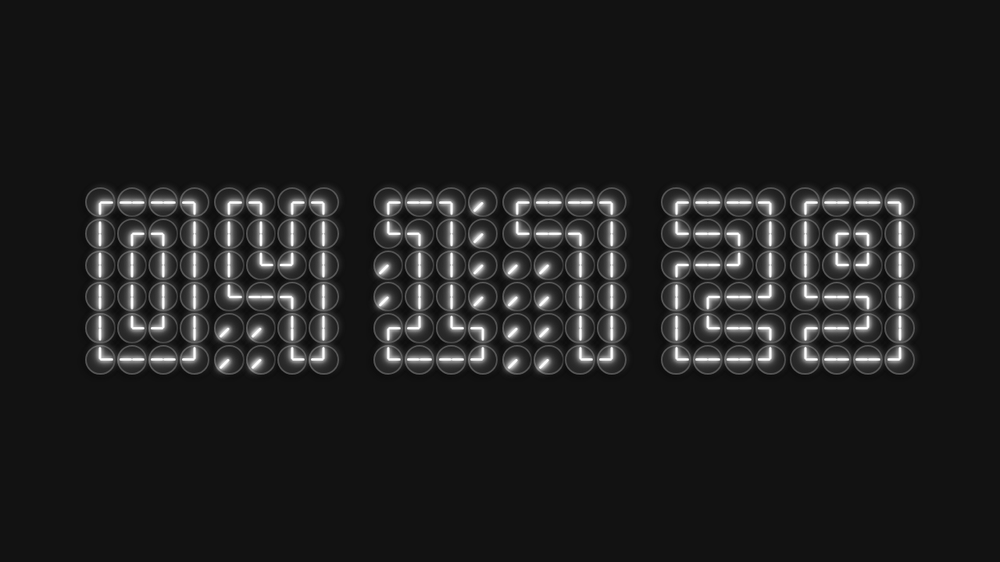

# clockinaclock

**Live demo:** https://chandrasen74.github.io/clockinaclock/  
**Repository:** https://github.com/Chandrasen74/clockinaclock



## Overview
`clockinaclock` is a creative "clock made of clocks" time visualization. It renders the current time using a grid of analog clocks whose hands form each digit.

- **Primary language:** JavaScript
- **Languages detected:** HTML, JavaScript, CSS
- **Stack/tech:** React (loaded via ESM), HTML, CSS, JavaScript
- **Entry point:** `index.html`

## Controls (keyboard shortcuts)
| Key | Action |
| --- | --- |
| `1` | Toggle 12-hour / 24-hour time format |
| `2` | Spin animation (randomizes clock hands briefly) |
| `3` | Toggle dark / light theme |

## Language & stack details
- Languages: HTML, JavaScript, CSS
- Frameworks/tools/libraries: HTML, CSS, JavaScript

## How to install & run
### Prerequisites
- A modern web browser
- (Optional) [Python 3](https://www.python.org/) or any static file server for local serving

### Run locally
```bash
git clone https://github.com/Chandrasen74/clockinaclock.git
cd clockinaclock
```
- **Option 1:** open `index.html` directly in your browser
- **Option 2:** serve locally (recommended for some JS features):
```bash
python -m http.server 8000
# then open http://localhost:8000
```

## Repository structure (top-level/sample)
- `README.md`
- `index.html`
- `screenshot.png`
- `script.js`
- `style.css`

## Status
Documented with screenshot, language/stack details, setup instructions, and keyboard shortcuts.
